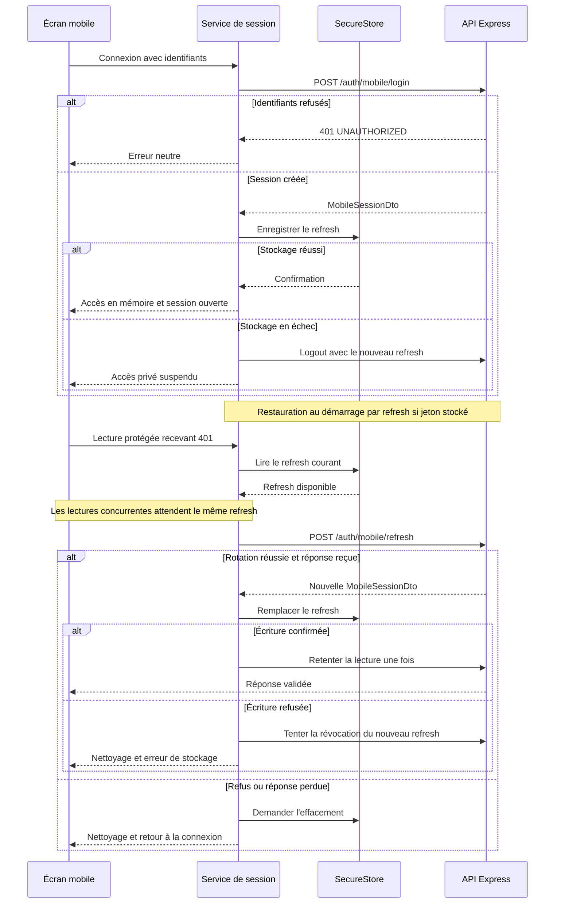
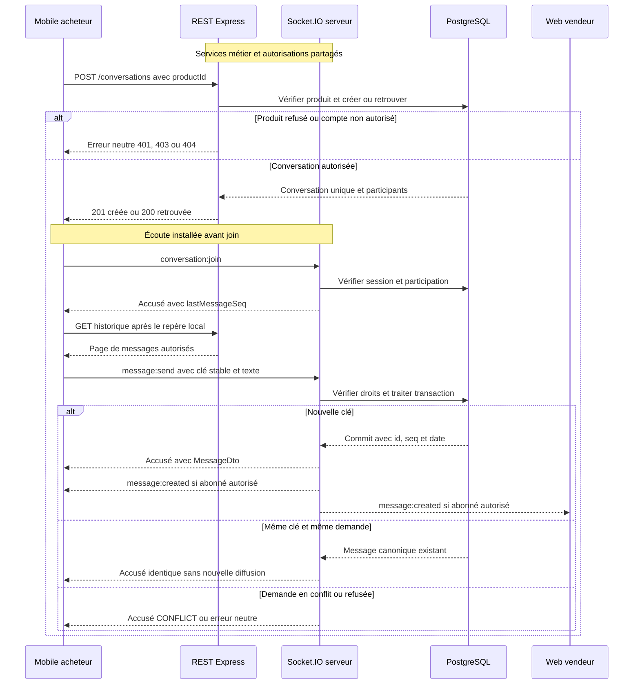
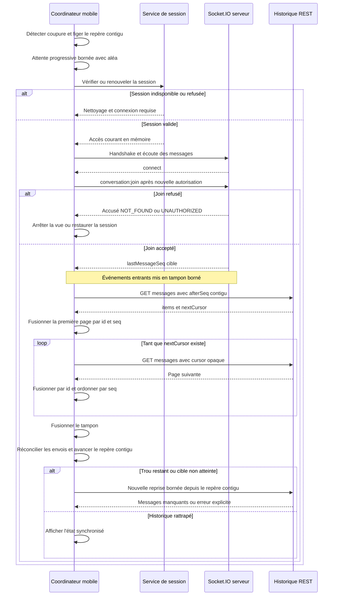

# Diagrammes des flux prévus

Statut **Prévu** pour les trois flux. Ils illustrent les [contrats REST](rest-mobile.md), le [contrat Socket.IO](messagerie-temps-reel.md) et l'[architecture](architecture.md). Les opérations métier représentées restent à implémenter et à tester. Les libellés de jetons désignent des catégories de données et ne contiennent aucune valeur secrète.

## 1. Connexion et renouvellement

Le serveur réalise la rotation atomique et la révocation. Un refus ne déclenche pas de boucle de refresh. Le traitement des échecs de stockage et de réponse perdue suit le contrat proposé. Le résultat de toute révocation best effort reste à constater. La déconnexion ou le changement de compte pendant ces échanges invalide les callbacks de l'ancienne génération locale.

## 2. Conversation et envoi

Le diagramme suppose un handshake valide et un join accepté avant l'envoi. Tout refus de join arrête la branche d'abonnement. La création et la participation sont garanties transactionnellement côté service, en réutilisant les tables existantes. L'accusé et la diffusion peuvent arriver dans un ordre différent. Le secours `POST /conversations/:id/messages` utilise la même clé et le même service. Une panne après commit peut perdre la diffusion, la reprise REST assure alors le rattrapage.

## 3. Reconnexion et messages manquants

Un échec de handshake retourne au traitement d'erreur de connexion et au budget de tentatives. Chaque page REST peut être refusée, y compris après un join réussi. Un 404 termine l'accès, un 401 passe par le service de session, un 429 suspend les reprises selon le délai fourni. Le contrôle périodique au premier plan et le retour d'arrière-plan couvrent aussi une diffusion perdue sans coupure visible. Une synchronisation réussie doit être prouvée par les identifiants et numéros persistés.
